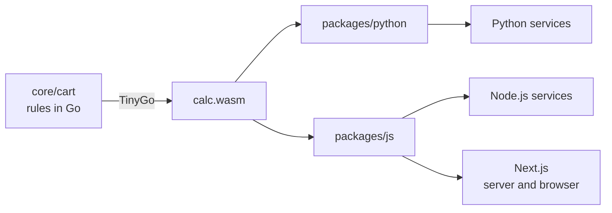

# ecommerce-cart-core

A proof of concept that puts the e-commerce cart calculation in a single place.

**The problem:** the cart pricing rules tend to be reimplemented in every project: Python
services, the Next.js storefront, internal Node.js services. Each copy drifts a little from the
others, and the customer sees one total in the cart and another at checkout. Floating point makes
it worse: `0.1 * 3` is `0.30000000000000004`.

**The solution:** the rules are written once in Go and compiled with TinyGo into a single file,
`calc.wasm`. That same file ships inside two packages with the same API, `calculate(cart)`:

- a Python package ([`packages/python`](packages/python)), which runs the `.wasm` with wasmtime;
- an npm package ([`packages/js`](packages/js)), which works in plain Node.js and in Next.js
  (Server Components, Route Handlers and Client Components in the browser).

So every project gets the same result, cent for cent. The test suites of all three languages run
the same input and expected output files ([`fixtures/`](fixtures)) to guarantee it.



## Quick start

All you need is Docker and `make`; everything else runs in containers.

```sh
make test     # build everything and run every test suite
make demo     # run the same checkout in Python and in Node.js and compare the outputs
make nextjs   # serve the Next.js example at http://localhost:3000
make build    # build the packages into dist/
```

`make build` writes what would be published:

```
dist/calc.wasm
dist/python/ecommerce_cart_core-0.1.0-py3-none-any.whl   (and the .tar.gz)
dist/js/ecommerce-cart-core-0.1.0.tgz
```

Other projects install the packages straight from those files:

```sh
pip install /path/to/dist/python/ecommerce_cart_core-0.1.0-py3-none-any.whl
npm install /path/to/dist/js/ecommerce-cart-core-0.1.0.tgz
```

## Usage

Python:

```python
from ecommerce_cart_core import calculate

result = calculate({
    "cartItems": [
        {"sku": "COFFEE-500G", "ean": "7891234000019", "name": "Ground Coffee 500g",
         "price": 18.90, "quantity": 2, "stock": 40},
    ],
    "offers": [
        {"sku": "COFFEE-500G", "price": 18.90, "discountedPrice": 15.90},
    ],
})
result["summary"]["totalCents"]  # 3180
```

JavaScript (Node.js, Next.js, the browser):

```js
import { calculate } from 'ecommerce-cart-core';

const result = await calculate({
  cartItems: [
    { sku: 'COFFEE-500G', ean: '7891234000019', name: 'Ground Coffee 500g', price: 18.9, quantity: 2, stock: 40 },
  ],
  offers: [{ sku: 'COFFEE-500G', price: 18.9, discountedPrice: 15.9 }],
});
result.summary.totalCents; // 3180
```

Both take the cart object or its JSON text and return the same result. In JavaScript `calculate`
returns a `Promise`; in Python it is synchronous. Invalid input raises (or rejects with) a
`CartError` with `code`, `message` and `path`. The package READMEs
([Python](packages/python/README.md), [JavaScript](packages/js/README.md)) cover what is specific
to each one.

## Input

An object with the cart items and, optionally, the offers in force. In the tests,
[`fixtures/cart.json`](fixtures/cart.json) and [`fixtures/offers.json`](fixtures/offers.json) are
merged into that object.

```json
{
  "cartItems": [
    { "sku": "COFFEE-500G", "ean": "7891234000019", "name": "Ground Coffee 500g", "price": 18.90, "quantity": 2, "stock": 40 }
  ],
  "offers": [
    { "sku": "COFFEE-500G", "ean": "7891234000019", "price": 18.90, "discountedPrice": 15.90 }
  ]
}
```

| Field | Item | Offer | Rules |
|---|---|---|---|
| `sku` | required | optional | non-empty string |
| `ean` | optional | optional | EAN-8, UPC-A, EAN-13 or GTIN-14 with a valid check digit; an offer needs `sku` or `ean` |
| `name` | optional | | |
| `price` | required | required | the item's unit price, or the regular price the offer was created for |
| `discountedPrice` | | required | the offer price |
| `quantity` | required | | integer, at least 1 |
| `stock` | required | | integer, at least 0 |

Amounts may be JSON numbers (`18.9`) or decimal strings (`"18.90"`). They are read from their
text, never converted to floating point, and must be exact cents: `49.999` and
`0.30000000000000004` are refused, not rounded. Unknown fields are ignored.

## Output

Every amount is in **integer cents**. Abridged from [`fixtures/expected.json`](fixtures/expected.json):

```json
{
  "valid": false,
  "issues": [],
  "summary": { "itemCount": 5, "unitCount": 10, "subtotalCents": 18660, "discountCents": 1900, "totalCents": 16760 },
  "items": [
    {
      "sku": "OLIVE-OIL-500ML", "ean": "7891234000033", "name": "Extra Virgin Olive Oil 500ml",
      "status": "adjusted", "requestedQuantity": 4, "quantity": 2,
      "unitPriceCents": 3990, "finalUnitPriceCents": 3490,
      "subtotalCents": 7980, "discountCents": 1000, "totalCents": 6980,
      "offerApplied": true,
      "issues": [{ "code": "QUANTITY_ADJUSTED", "message": "Quantity reduced from 4 to 2 due to limited stock." }]
    }
  ]
}
```

- `valid`: the cart can go to payment exactly as submitted (everything is available and there is
  something to buy). When it is `false`, the `issues` say what changed.
- `status` of an item: `ok`, `adjusted` (quantity reduced to the stock) or `unavailable` (out of
  stock, not charged).
- `quantity` is what will be charged; `requestedQuantity` is what was asked for.
- `subtotalCents = unitPriceCents × quantity`, `totalCents = finalUnitPriceCents × quantity`, and
  `discountCents` is the difference. In the `summary`, `totalCents = subtotalCents − discountCents`.
- Each issue has a stable `code`, for programs, and a `message` ready to show to the customer. To
  show text in another language, map the `code`.

To display an amount, format the cents; the engine has already done the math.

## Rules

Implemented in [`core/cart/calculate.go`](core/cart/calculate.go), in this order:

1. **Validation.** Invalid values (a negative price, a quantity below 1, an EAN with a wrong check
   digit, an offer with neither `sku` nor `ean`...) make the calculation fail with
   `INVALID_INPUT`, pointing at the field in `path` (e.g. `cartItems[2].price`). They mean the
   calling system has a bug, so nothing is calculated.
2. **Repeated SKUs.** Lines with the same SKU are merged before checking stock: two lines of 3
   units with a stock of 5 become one line of 6, adjusted to 5. The lines must agree on price,
   stock and EAN.
3. **Stock.** The quantity is capped at the stock (`adjusted`); without stock, the item is
   `unavailable` and costs nothing.
4. **Offers.** An offer applies to an item when every identifier it provides (`sku`, `ean`) is
   the item's. EANs are compared as GTIN-14, so UPC-A `036000291452` and EAN-13 `0036000291452`
   are the same product. The offer is applied only if its `price` is still the item's price
   (otherwise it is stale) and its `discountedPrice` is lower. Among the valid offers, the lowest
   price wins.
5. **Totals** in integer cents, with no rounding.

Issue codes:

| Code | Level | Meaning |
|---|---|---|
| `DUPLICATE_SKU_MERGED` | item | the SKU appeared in more than one line; the quantities were added up |
| `QUANTITY_ADJUSTED` | item | the quantity was reduced to the available stock |
| `OUT_OF_STOCK` | item | out of stock; not charged |
| `OFFER_PRICE_MISMATCH` | item | offer ignored: its `price` is no longer the product's price |
| `OFFER_WITHOUT_DISCOUNT` | item | offer ignored: its `discountedPrice` is not lower than its `price` |
| `EMPTY_CART` | cart | there is nothing available to buy |

Error codes (`CartError.code`): `INVALID_JSON`, `INVALID_INPUT` and `ENGINE_ERROR` (an internal
failure of the engine).

## Conformance tests

[`fixtures/`](fixtures) is the source of truth shared by the three test suites:

- `cart.json` + `offers.json` → `expected.json`: the checkout simulation. It covers an applied
  offer, an offer matched by EAN only, a stale offer, partial stock, a sold-out item, a repeated
  SKU and R$ 0.10 × 3.
- [`scenarios/`](fixtures/scenarios): one file per edge case, with the input and the expected
  result (`expected`) or error (`expectedError`).

The Go suite runs the fixtures directly on the code; the Python and JavaScript suites run them
through the compiled `calc.wasm`. When all three pass, the same cart gives the same result
everywhere. After changing a rule on purpose, regenerate the expected outputs with
`make fixtures` and review the diff.

## Development

Everything runs in Docker: the only requirements are Docker and `make`. Go, TinyGo, Python and
Node.js live inside the images, and the working tree never gets a `.venv` or `node_modules`.

```sh
make                   # list the targets
make build             # calc.wasm and the Python and npm packages, in dist/
make build-go          # only calc.wasm (also build-python and build-js)
make test              # every test suite, on the default versions
make test-js           # one suite (also test-go, test-python and test-nextjs)
make test-python-3.9   # one suite on one version (e.g. test-go-1.25, test-js-18)
make test-versions     # every suite on every supported version
make demo              # the same checkout in Python and in Node.js, with the outputs compared
make nextjs            # the Next.js example at http://localhost:3000
make fixtures          # regenerate the expected outputs in fixtures/
make clean             # delete dist/, the containers and the images of the project
```

| Runtime | Default | `make test-versions` |
|---|---|---|
| Go | 1.27 | 1.25, 1.26 and 1.27 |
| Python | 3.13 | 3.9 to 3.15 |
| Node.js | 24 | 18, 20, 22, 24 and 26 |

`calc.wasm` is compiled with TinyGo 0.43.0. To change a version for one run:
`make test-js NODE_VERSION=22`.

| File | What it does |
|---|---|
| [`core/Dockerfile`](core/Dockerfile) | `test`: gofmt, `go vet` and `go test`. `wasm`: compiles `calc.wasm` |
| [`packages/python/Dockerfile`](packages/python/Dockerfile) | builds the wheel and sdist with `calc.wasm` and runs pytest on the installed package |
| [`packages/js/Dockerfile`](packages/js/Dockerfile) | builds the `.tgz` and runs the tests on the packed files |
| [`examples/nextjs/Dockerfile`](examples/nextjs/Dockerfile) | production build of the example, with the npm package built above |
| [`docker-compose.yml`](docker-compose.yml) | wires it together: the `calc.wasm` of `core` reaches the packages through `additional_contexts` |

The package tests run on what users install: the installed wheel and the files of the `.tgz`.
Both check that they carry exactly the `calc.wasm` compiled from `core`.

`docker compose up` starts only the Next.js example. The other services are build and test steps
(`scale: 0`) that `make` runs with `docker compose run`; to explore one, use, for instance,
`docker compose run --rm python bash`.

The [`examples/`](examples) run the same checkout from the fixtures: in Python and in plain
Node.js (`make demo` compares their outputs byte by byte), and in Next.js, where a Server
Component, a Client Component in the browser and a Route Handler (`POST /api/cart`) calculate the
cart and compare their totals (`make nextjs`).

## Design decisions

- **Integer cents and exact parsing.** Money is an `int64` number of cents, read from the JSON
  text without going through floating point. The engine never rounds: a value that is not an
  exact number of cents is an error. Every number in the output stays below 2^53, so JavaScript
  (which reads JSON numbers as float64) receives the exact value.
- **A `.wasm` with no imports.** TinyGo's `wasm-unknown` target builds a module that depends on
  neither WASI nor anything from the host, so the same binary runs under wasmtime, Node.js and
  browsers. The interface is JSON: the host writes the input into the module's memory (`alloc`),
  calls `calculate` and reads the response (details in
  [`core/cmd/wasm/main.go`](core/cmd/wasm/main.go)).
- **A conservative GC.** The default GC of `wasm-unknown` never frees memory: 10,000 calls took an
  instance to 256 MB. With `-gc=conservative` it stays at 0.3 MB, and a test of the npm package
  checks it.
- **One instance per process.** Created on the first call (about 10 ms in Node.js, 45 ms in
  Python) and reused: after that, the example cart takes about 50 µs in Node.js and 150 µs in
  Python. In Python, calls are serialized by a lock and the instance is recreated after a `fork`.
  Both packages discard the instance if the module fails.
- **The `.wasm` embedded as base64 in the npm package** and loaded with a dynamic `import()`. It
  works without configuration in any bundler and environment, and the browser downloads the engine
  (182 KB gzipped) only when `calculate` is first called. The cost is about 30% more download than
  the plain `.wasm` (139 KB gzipped).
- **The size of `calc.wasm`.** Go 1.27 builds `encoding/json` on its v2 implementation, which
  doubles the binary (701 KB instead of 331 KB). The build sets `GOEXPERIMENT=nojsonv2`; the
  fixtures pass with both implementations.
- **A nesting limit.** JSON nested more than 64 levels deep is refused before decoding, so that
  malicious input cannot exhaust the module's stack.
- **Go is a client too.** Go services can import `core/cart` directly, without WebAssembly (after
  changing the module path in `core/go.mod` to a real repository path).

## Next steps

- A CI pipeline that runs `make test-versions` and `make build` and publishes `dist/` to a private
  registry, with the same version in both packages. The packages are marked so that they cannot go
  to the public npm and PyPI by mistake (`"private": true` and `Private :: Do Not Upload`).
- The Edge Runtime (Vercel Edge, Cloudflare Workers) does not allow compiling WebAssembly from
  bytes; it would need a variant that imports the `.wasm` as a module.
- More rules in the same place: coupons, percentage discounts (with a single rounding policy),
  shipping, installments, and offer validity windows and per-customer limits.
